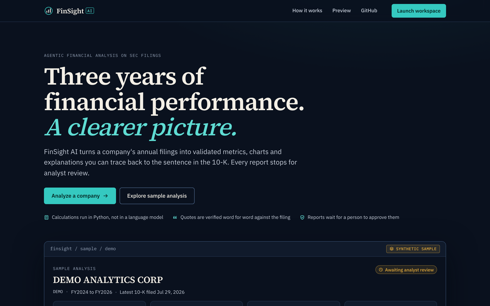
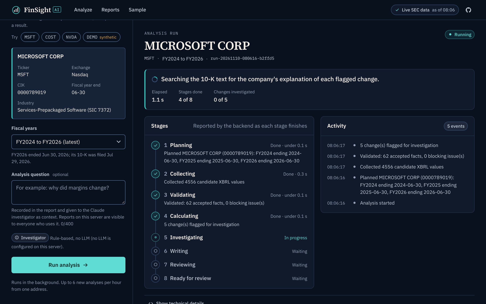
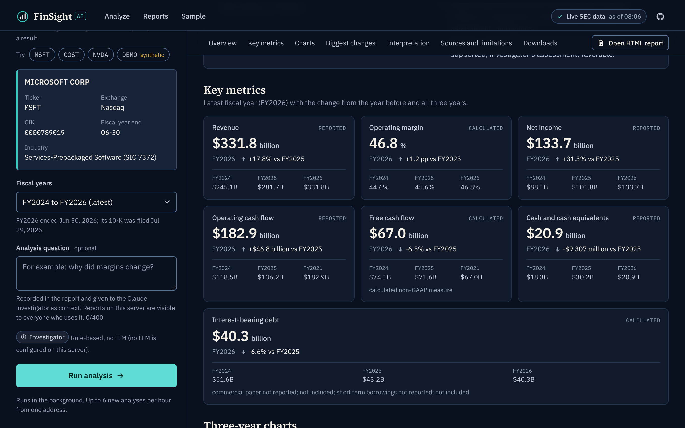
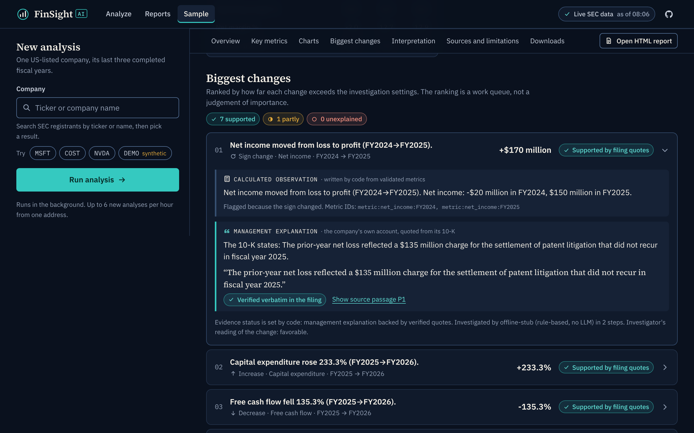
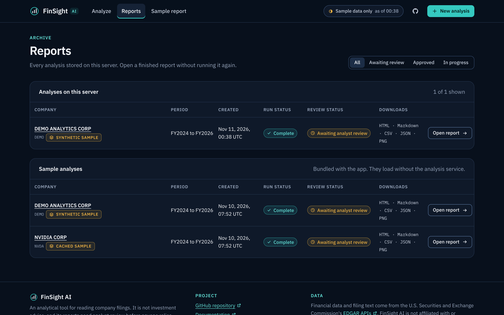
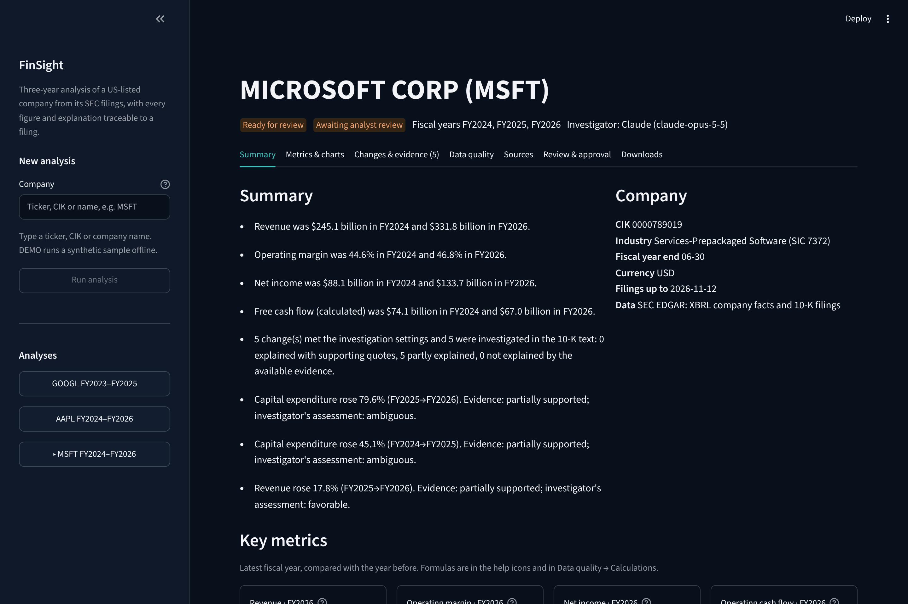
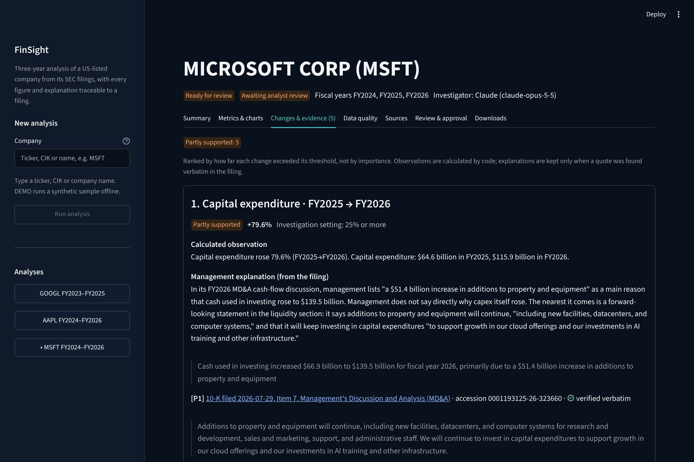
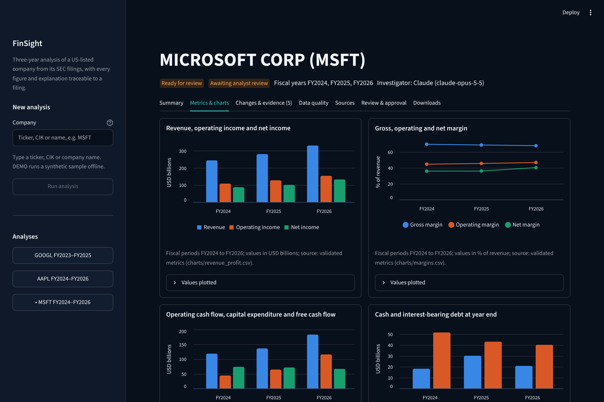
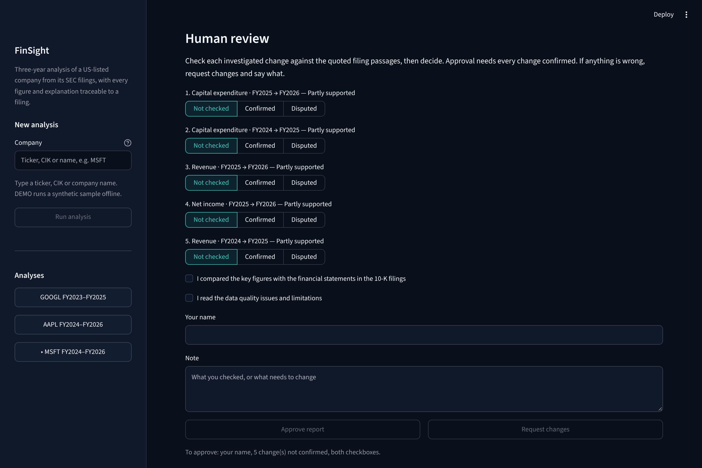

# FinSight AI

FinSight AI analyses how a US-listed company performed over its last three completed fiscal
years, using its SEC filings. It collects the reported figures, validates them, calculates
metrics in Python, finds the largest changes, looks for the company's own explanation of each
one in its 10-K, and writes a report with charts in which every number and quote can be traced
to a filing. A person reviews and approves the report; the system never approves its own work.

It has three front ends over one engine: a **web app** (React + FastAPI), a **Streamlit dashboard**
and a **CLI**.



| Analysis in progress | Report summary (stored real-company sample) |
|---|---|
|  |  |
| **Findings with evidence** | **Report archive** |
|  |  |

The screenshots are from the app running locally. The "Demo Analytics Corp" company is a
synthetic fixture and is labelled as such everywhere it appears.

## Web app

### Run it locally

Needs Python 3.11+ and Node 20+.

```bash
python -m venv .venv && source .venv/bin/activate
pip install -e ".[dev]"

cd web && npm ci && npm run build && cd ..     # build the frontend once
finsight-api                                    # http://127.0.0.1:8000 serves the API and the app
```

With nothing else configured the app runs the **synthetic sample company** (ticker `DEMO`)
end to end, offline and without keys. To analyse real companies, identify yourself to the SEC
before starting the server (see [Configuration](#configuration)):

```bash
export FINSIGHT_SEC_USER_AGENT="Your App Name contact@your-domain.example"
export ANTHROPIC_API_KEY=...      # optional: Claude investigator instead of the rule-based one
finsight-api
```

For frontend development, run the API and the Vite dev server side by side. The dev server
proxies `/api` to port 8000:

```bash
finsight-api                      # terminal 1
cd web && npm run dev             # terminal 2, http://localhost:5173
```

### What is in it

* **Landing page** (`/`): what the product does, a preview built from the real results
  screen, the workflow, capabilities, data sources and limits.
* **Workspace** (`/app`): company search with autocomplete (ticker, name, exchange),
  company details, a three-year period that defaults to the latest completed fiscal years,
  an optional analysis question.
* **Progress** (`/app/runs/<id>`): the eight backend stages with what each one found,
  elapsed time, warnings and an activity feed. The page polls the run by its ID, so a
  refresh or a shared link reconnects to the same run. No percentages are invented.
* **Results**: company overview, key metrics, four charts with table views, ranked changes
  with evidence status and source passages, a per-area interpretation, sources and
  limitations, and downloads. Calculated observations, management explanations and AI
  interpretation are labelled separately.
* **Reports** (`/app/reports`): every stored analysis with run status and review status
  (awaiting review or approved), opened without rerunning.
* **Sample analyses** (`/app/sample/demo`, `/app/sample/nvda`): bundled static copies of real
  pipeline runs. One is the synthetic company, one is a cached run on real filings. Both are
  labelled, and both work when the backend is down.

Live and sample data are never mixed: if live SEC access is not configured or fails, the app
says so and offers the sample. It does not substitute demo figures.

### Commands

| Task | Command |
|---|---|
| Backend and dashboard tests (offline) | `pytest` |
| Frontend type check and production build | `cd web && npm run build` |
| Browser tests (desktop, tablet, phone) | `cd web && npx playwright install chromium && npx playwright test` |
| Regenerate API types after changing `finsight/api/schemas.py` | `python scripts/export_openapi.py && (cd web && npm run gen:api)` |
| Rebuild the bundled samples | `python scripts/build_web_sample.py` (add `--live NVDA` to refresh the cached real-company run) |
| Container image | `docker build -t finsight . && docker run -p 8000:8000 -v finsight-data:/data finsight` |

The browser tests start their own offline server on port 8765; set `FINSIGHT_PYTHON` if
`python` is not the interpreter with FinSight installed. GitHub Actions runs all of the
above on every pull request ([.github/workflows/tests.yml](.github/workflows/tests.yml)).

### Deploying

GitHub hosts the code. The app itself needs a host that can run the Python backend; GitHub
Pages cannot, it only serves static files. The recommended path is one Docker web service
with a persistent disk, described step by step with costs in
[docs/deployment.md](docs/deployment.md). **This repository is not deployed anywhere yet.**

## Streamlit dashboard

A single-process analyst dashboard: pick a company, run the orchestrated pipeline, read the
results and record a review decision. It needs no Node build.

```bash
pip install -e ".[dashboard]"
export FINSIGHT_SEC_USER_AGENT="Your App Name contact@your-domain.example"   # for real companies
export ANTHROPIC_API_KEY=...                                                # optional: Claude investigator
finsight-dashboard                       # http://localhost:8501 (extra args go to `streamlit run`)
```

Without `FINSIGHT_SEC_USER_AGENT` only the synthetic sample (`DEMO`) can be analysed, and the
dashboard says so. Runs, results and review decisions are stored in the same SQLite database as
the CLI and the web app (`.finsight/` under `FINSIGHT_HOME`, default the current directory).

| Summary and key metrics | Changes with cited explanations |
|---|---|
|  |  |
| **Charts** | **Human review** |
|  |  |

Screenshots are from a live run on Microsoft's FY2024 to FY2026 10-K filings with the Claude
investigator.

* **Sidebar**: company search against SEC EDGAR's ticker list, the three-year window (defaults to
  the latest completed fiscal year), an optional question, Claude on or off, and the list of
  stored analyses.
* **Progress**: the eight stages with what each found, refreshed every two seconds. A run that
  failed or was interrupted resumes from its last completed stage; an ambiguous company name
  asks which company you meant.
* **Summary, Metrics & charts**: key metrics with formulas, four charts with the plotted values,
  the financial and year-over-year tables.
* **Changes & evidence**: each flagged change with its calculated observation, the management
  explanation, the filing quotes (verified verbatim or not) linked to the 10-K section on EDGAR,
  any AI interpretation labelled as such, and open questions.
* **Data quality, Sources**: validation issues, missing figures, every calculation with its input
  facts, fiscal periods with their defining 10-K, cited passages with character offsets, and every
  retrieved document with its SHA-256.
* **Review & approval**: the automated reviewer's result, then the human review. The reviewer
  marks each investigated change *Confirmed* or *Disputed*, confirms they compared the figures with
  the filings and read the limitations, and gives their name. **Approve** is enabled only when every
  change is confirmed; **Request changes** keeps the report unapproved and records why. Every
  decision is appended to the run (`run.stats.human_reviews`) and appears in `run_summary.json`.
* **Downloads**: the report preview and every export file listed under [CLI](#cli).

The dashboard has no financial logic of its own. It drives the same `Orchestrator` on a background
thread and builds its views with the web API's view builders (`finsight/api/views.py`), so its
numbers are identical to the report and the downloads. `streamlit run finsight/dashboard/app.py`
from the repository root also works and picks up `.streamlit/config.toml`.

## CLI

### Quick start

```bash
python -m venv .venv && source .venv/bin/activate
pip install -e ".[dev]"

# Offline demo: bundled SYNTHETIC fixture, no network, no API keys
finsight analyze DEMO --offline --cutoff 2026-11-01

# Live SEC data. SEC requires automated clients to identify themselves.
export FINSIGHT_SEC_USER_AGENT="FinSight research your-name@your-domain.com"
finsight analyze MSFT                                # investigator: Claude if ANTHROPIC_API_KEY is set, else the stub
export ANTHROPIC_API_KEY=...                         # read by the Anthropic SDK; never stored or logged
export FINSIGHT_LLM_MODEL=claude-opus-5-5            # optional; default in config/settings.toml
finsight analyze MSFT --question "Why did margins change?"
finsight analyze MSFT --llm stub                     # force the rule-based offline stub (no LLM, no cost)
finsight analyze MSFT --no-investigate               # Stage 1 only
finsight analyze MSFT --cutoff 2025-12-31            # only filings available by that date
finsight analyze "Microsoft" --latest-fy 2025        # name lookup; window ends with FY2025
```

Each run prints the fiscal periods (with the 10-K that defines each one), a financial
table, year-over-year changes, flagged changes, each finding with its evidence status, the
review result and validation issues. It also writes these files to `out/<run_id>/`:

| File | Contents |
|---|---|
| `financial_dataset.csv` | Accepted values per field and fiscal year, full precision, USD |
| `metrics.csv` | Every metric with formula, status, note and input fact / metric IDs |
| `facts_audit_trail.csv` | Accepted, alternative (e.g. pre-restatement) and rejected candidates, each with a reason |
| `validation_issues.csv` | Issues by severity |
| `analysis.json` | Plan, sources (URL, retrieval time, SHA-256), validation report, metrics, flags |
| `run_summary.json` | State history, stats (coverage, cache hits, duration, LLM calls/tokens/estimated cost, review result) |
| `report.md`, `report.html` | The report: summary, table, charts, ranked changes, explanations, limitations, sources, calculation notes. The HTML is self-contained |
| `charts/*.png`, `charts/*.csv` | Four charts and the exact values plotted, with metric IDs |
| `findings.json` | Each finding: observation, management explanation, verified quotes, interpretation, unresolved questions, status, tool trace |
| `review.json` | Every review cycle: checks run, defects, where each was routed |
| `evidence_passages.csv` | Every cited filing passage with accession, section, character range and URL |

Other commands:

```bash
finsight runs                                 # recent runs
finsight show <run_id> [--export]
finsight resume <run_id>                      # continue an interrupted or failed run
finsight resume <run_id> --company 9999901    # answer a "which company?" question
finsight approve <run_id> --note "checked"    # READY_FOR_REVIEW -> APPROVED (always explicit)
```

Exit codes: `0` ready for review / partial / approved, `2` failed, `3` needs input.

## Research report (PDF)

A finished analysis can be turned into an equity research report laid out like the written
report in the CFA Institute Research Challenge rules: at most ten A4 pages of body plus an
appendix, with a header that gives the company name, exchange, ticker, sector, industry,
recommendation (buy/hold/sell), current price with its date, and target price with the
percentage change. The body has an Investment Summary, Business Description, Industry Overview
and Competitive Positioning, Valuation, Financial Analysis, Investment Risks, and Environmental,
Social and Governance. The first page is a **placeholder for the CFA Institute front cover**:
FinSight never reproduces the cover or its logo. The placeholder lists the values for the
cover's highlighted fields.

```bash
finsight research-pdf <run_id> --price 521.13 --price-date 2026-11-11 \
    --price-source "Nasdaq official closing price" [--price-url https://...]
finsight research-pdf <run_id> --market docs/research/prices-2026-11-11.json
finsight research-pdf <run_id> --no-llm            # quote the 10-K instead of AI-drafted summaries
finsight research-pdf <run_id> --discount-rate 9 --terminal-growth 2.5   # override assumptions
```

In the dashboard, open **Downloads**, enter the price, its date and its source, and press
**Build research PDF**; the PDF then appears in the download list. The web app lists it too once
it has been built.

Where each part comes from:

| Part | Source |
|---|---|
| Exchange, sector, industry | SEC submissions file: `exchanges`, the SEC review office (`ownerOrg`, used as the sector) and the SIC code. Not GICS. |
| Every financial figure | FinSight's validated metrics, by metric ID (Appendix A lists formula and inputs). |
| Diluted shares, short-term investments | us-gaap facts from the latest 10-K, by tag and accession. |
| Current price | **Supplied by you**, with its date and source. FinSight does not fetch prices; with no price the report is *Not rated*. |
| Target price | DCF in `finsight/research/valuation.py`: latest revenue × average FCF margin over the analysed years, growth starting at the revenue CAGR (bounded 0 to 15%) and fading to terminal growth over ten years, discounted at risk-free + beta × equity risk premium. Assumptions and the risk-free rate (with its source) are in `config/research.toml`. Sensitivity table, implied multiples and a reverse DCF are printed with it. |
| Recommendation | A fixed rule on the target's upside: BUY at +10% or more, SELL at −10% or less, otherwise HOLD. |
| Business, industry, risks, ESG | The company's latest 10-K (Items 1 and 1A). With Claude: short summaries that must quote the filing; a paragraph is dropped unless a quote matches the passage verbatim, or if it states a figure none of its quotes contains. Without Claude: verbatim extracts. |
| Management explanations | The run's reviewed findings, with their verified quotes. |

Every statement carries `[S#]` citations that resolve to Appendix C (filing, accession, section,
character offsets, link). The report is labelled as model-generated on every page and carries
the run's human review status; until the analysis is approved, every page is watermarked
**DRAFT · NOT APPROVED**. ESG coverage is limited to what the 10-K says: proxy statements and
third-party ESG ratings are not used.

## Configuration

All variables are listed with comments in [.env.example](.env.example). API keys are read
on the server only and are never sent to the browser.

| Where | What |
|---|---|
| `FINSIGHT_SEC_USER_AGENT` | **Required for live runs.** Your name/app and a contact address. Never logged or committed. |
| `ANTHROPIC_API_KEY` | Enables the Claude investigator and LLM review. Read by the Anthropic SDK only. |
| `FINSIGHT_LLM_MODEL` | Claude model (default `claude-opus-5-5`). |
| `FINSIGHT_HOME` | Base folder for `.finsight/` cache + database and `out/` (default: current directory) |
| `FINSIGHT_CONFIG_DIR` | Alternative config folder |
| `FINSIGHT_PUBLIC_INVESTIGATOR` | Web API: `auto` (default) or `rule_based` to keep visitors on the free investigator even when a key is set |
| `FINSIGHT_REVIEWER_TOKEN` | Web API: if set, approving a report needs this value (`X-Reviewer-Token`) |
| `FINSIGHT_CORS_ORIGINS` | Web API: browser origins allowed to call the API when the frontend is hosted elsewhere. Empty (default) means same-origin only |
| `FINSIGHT_RUNS_PER_HOUR`, `FINSIGHT_MAX_CONCURRENT_RUNS`, `FINSIGHT_MAX_QUEUED_RUNS`, `FINSIGHT_LOOKUPS_PER_MINUTE`, `FINSIGHT_RUN_BUDGET_SECONDS` | Web API limits (defaults 6, 2, 4, 60, 900) |
| `FINSIGHT_TRUSTED_PROXY_HOPS` | Web API: number of reverse proxies in front, so rate limits count the visitor's address |
| `HOST`, `PORT` | Web API bind address (default `127.0.0.1:8000`) |
| `VITE_BASE`, `VITE_API_BASE_URL` | Frontend build only: path prefix and API origin when the frontend is hosted separately |
| `config/settings.toml` | Request pacing, retries, backoff, period rules, tolerances, change thresholds, unsupported industries, investigation budgets (`[investigation]`), LLM settings and run budget (`[llm]`) |
| `config/mappings.toml` | Standardized field → ordered XBRL tags, sign rules, derivations |
| `config/companies/<CIK>.toml` | Per-company tag overrides |
| `config/research.toml` | Research report: DCF assumptions, dated risk-free rate with its source, rating thresholds |

The change thresholds (revenue ±10%, operating margin ±3 pp, free cash flow ±20%, net
income ±20%, capital expenditure ±25%, debt +25%, materiality 0.5% of revenue) are
investigation settings, not financial standards.

## How findings are evidenced

* The **calculated observation** is written by code from validated metrics.
* A **management explanation** is reported only if backed by quotes that code finds
  verbatim in the cited 10-K passage. It is always attributed to the company.
* An **analyst interpretation** is optional, labelled, and flagged by the reviewer if it
  states a cause without hedging.
* **Unresolved questions** say what the filings did not explain.
* Evidence status (supported / partially supported / unsupported) is set by code; the
  model can lower it, never raise it. Self-reported confidence is not used.

Without an API key (or with `--offline`) a **rule-based stub** stands in for Claude so the
whole workflow runs for free. It is labelled everywhere it is used and is deliberately
conservative: it only quotes sentences whose subject is the flagged item and that state a
cause, so on real filings it leaves many changes "unexplained" that Claude can explain.

## Scope

Supported: US domestic, nonfinancial operating companies that file Form 10-K in USD.
Banks, broker-dealers, insurers, REITs and other SIC 6000–6799 filers, and foreign
private issuers (20-F/40-F), are refused with an explanation rather than given ratios
that do not fit them.

## Tests

```bash
pytest                                   # unit + offline end-to-end tests (no network)
FINSIGHT_RUN_LIVE=1 FINSIGHT_SEC_USER_AGENT="..." pytest -m live   # real SEC calls, opt-in
FINSIGHT_RUN_LIVE=1 FINSIGHT_RUN_LLM=1 ANTHROPIC_API_KEY=... pytest -m llm   # real Claude calls, costs money
```

The offline tests check the demo pipeline against values worked out by hand from
`scripts/build_demo_fixture.py`. They also cover restatements, a 10-K/A, a quarterly value
labelled as fiscal-year, duplicates and competing tags, sign handling, missing data,
balance-check failures, zero and negative denominators, retry and pacing behaviour, cache
reuse, bounded recovery, and resuming after a simulated crash. Stage 2 tests cover 10-K
section parsing (table of contents, running headers, notes), quote verification, the typed
tools (allowlist, invalid input, source budget), the step budget, fabricated quotes,
status rules, run budgets, LLM outages with resume, review revision cycles and their cap,
and every reviewer check against tampered drafts. Claude-only paths are tested with a
scripted fake model and a fake SDK client.

The API tests (`tests/unit/test_api.py`) run the whole web workflow offline: lookups, the run
lifecycle with real stage reporting, duplicate and rate limits, failure and resume, a run
interrupted by a restart, approval with and without a token, downloads and path traversal,
partial results from missing data, and checks that the OpenAPI file, the bundled samples
and the browser-test fixtures match the current contract. The Playwright tests in `web/e2e/`
drive the built app against that same offline backend at desktop, tablet and phone sizes.

## Project layout

```
finsight/
  contracts.py     typed schemas (AnalysisRequest … WorkflowRun)
  config.py        settings + field mappings loader
  sec/client.py    SEC HTTP client: identification, pacing, retries
  sec/sources.py   live source with cache, offline fixture source
  resolver.py      ticker / CIK / name → company, scope checks
  planner.py       fiscal-period selection → AnalysisPlan
  collector.py     company facts → candidate rows
  normalizer.py    period, restatement, tag, sign, derivation rules
  validator.py     accounting checks, coverage → ValidationReport
  metrics.py       deterministic metrics with lineage
  changes.py       rule-based change ranking
  workflow.py      state machine
  orchestrator.py  stage routing, recovery, checkpoints
  storage.py       SQLite
  export.py        CSV / JSON / report exports and display tables
  evidence/        10-K HTML -> section-aware passages; BM25 search; quote verification
  investigator/    typed tools, bounded loop, investigation stage
  llm/             provider interface, Anthropic provider, offline stub, provider choice
  report/          report writer (Markdown + HTML), chart specs and rendering
  research/        equity research report: header data, valuation, cited narrative, A4 PDF
  review/          deterministic + LLM reviewer
  presentation.py  number formatting and the parser the reviewer checks it with
  cli.py
  api/             FastAPI layer: schemas (the typed contract), views, background jobs, limits
config/            settings.toml, mappings.toml, companies/
fixtures/demo/     SYNTHETIC offline fixture (labelled), including synthetic 10-K text
scripts/           fixture generator, OpenAPI export, sample and browser-test fixture builders
tests/unit/        offline tests (engine and API)
tests/integration/ live SEC tests (opt-in)
web/               React + TypeScript frontend (Vite); e2e/ holds the Playwright tests
docs/              architecture, deployment, OpenAPI schema, screenshots
```

## Roadmap

1. **Stage 1:** data pipeline, CLI, offline demo.
2. **Stage 2 (this release):** filing-text retrieval, investigator with typed tools and step
   budgets, evidence-backed findings, report (Markdown/HTML) with charts and citations,
   reviewer with at most two revision cycles, Anthropic SDK behind a provider interface.
   Still to do: the single-prompt baseline for comparison.
3. **Stage 3 (this release):** web app: FastAPI layer, React workspace, progress, results
   dashboard, report archive, downloads, bundled samples, container image.
4. **Research report:** CFA-style PDF with valuation, rating and cited narrative.
5. **Later:** sign-in and per-user archives, a scheduled check for new 10-K
   filings, uploaded reports, industry profiles, peers.
