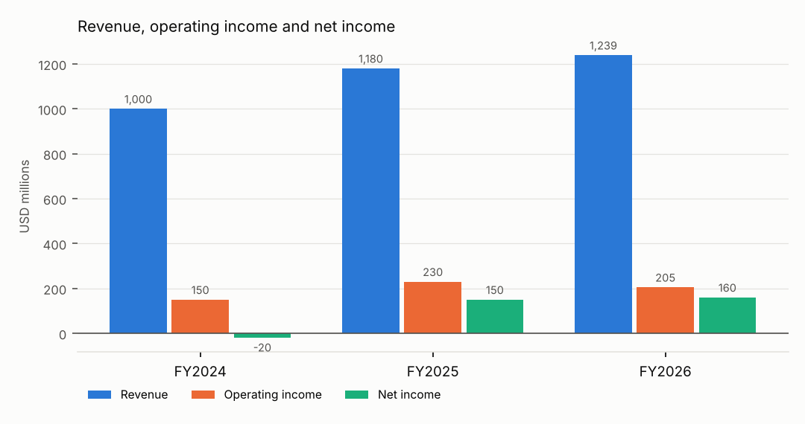
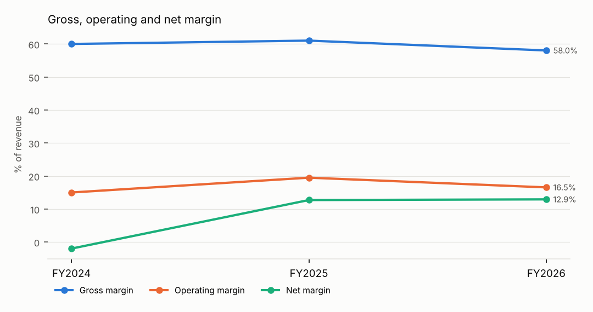
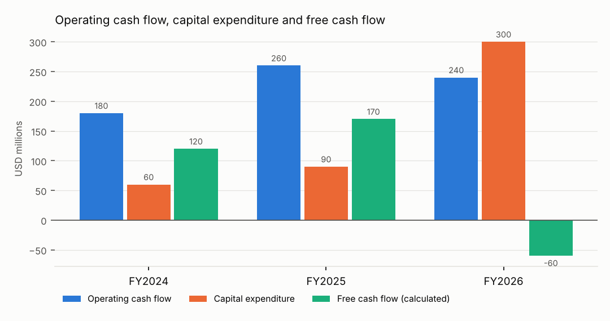
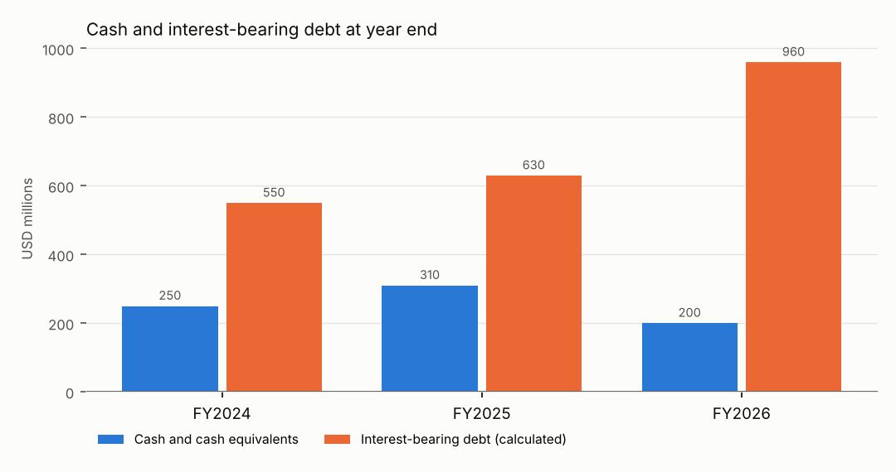

# DEMO ANALYTICS CORP (SYNTHETIC FIXTURE): three-year performance review (FY2024 to FY2026)

**OFFLINE DEMO: SYNTHETIC FIXTURE DATA. The company, figures and filing text are made up for testing and do not describe any real company.**

**Investigation by the OFFLINE STUB, a rule-based stand-in that is not an AI model: it quotes filing sentences that contain explicit attribution language and writes no interpretation. Narrative review by an LLM was not performed.**

**Status: READY FOR ANALYST REVIEW, not approved. This is an analytical report, not an investment recommendation.**

CIK 0009999901 · tickers DEMO · SIC 7372 Services-Prepackaged Software · currency USD · analysis cutoff 2026-11-01 · report revision 0

## Executive summary

- Revenue was $1,000 million in FY2024 and $1,239 million in FY2026. [M1][M2]
- Operating margin was 15.0% in FY2024 and 16.5% in FY2026. [M3][M4]
- Net income was -$20 million in FY2024 and $160 million in FY2026. [M5][M6]
- Free cash flow (calculated) was $120 million in FY2024 and -$60 million in FY2026. [M7][M8]

8 change(s) met the investigation settings and 8 were investigated in the 10-K text: 7 explained with supporting quotes, 1 partly explained, 0 not explained by the available evidence.

Largest changes by investigation priority:

- Net income moved from loss to profit (FY2024->FY2025). Evidence: supported; investigator's assessment: favorable. [M5][M9]
- Capital expenditure rose 233.3% (FY2025->FY2026). Evidence: supported; investigator's assessment: ambiguous. [M10][M11]
- Free cash flow fell 135.3% (FY2025->FY2026). Evidence: supported; investigator's assessment: unfavorable. [M12][M13]

## Three-year financial table

USD millions unless stated. Values are rounded for display; full precision is in `financial_dataset.csv` and `metrics.csv`.

| Line item | FY2024 | FY2025 | FY2026 |
|---|---|---|---|
| Revenue | 1,000 | 1,180 | 1,239 |
| Gross profit | 600 | 720 | 719 |
| Operating income | 150 | 230 | 205 |
| Net income | -20 | 150 | 160 |
| Operating cash flow | 180 | 260 | 240 |
| Capital expenditure | 60 | 90 | 300 |
| Free cash flow (calculated) | 120 | 170 | -60 |
| Cash and cash equivalents | 250 | 310 | 200 |
| Interest-bearing debt (calculated) | 550 | 630 | 960 |
| Gross margin % | 60.0 | 61.0 | 58.0 |
| Operating margin % | 15.0 | 19.5 | 16.5 |
| Net margin % | -2.0 | 12.7 | 12.9 |
| Current ratio (x) | 2.00 | 2.11 | 1.81 |

### Year-over-year changes

| Measure | FY2024->FY2025 | FY2025->FY2026 |
|---|---|---|
| Revenue growth % | +18.0 | +5.0 |
| Gross margin change (pp) | +1.0 | -3.0 |
| Operating margin change (pp) | +4.5 | -2.9 |
| Net margin change (pp) | +14.7 | +0.2 |
| Free cash flow growth % | +41.7 | -135.3 |
| Free cash flow change | 50 | -230 |
| Cash change | 60 | -110 |
| Debt change | 80 | 330 |

## Charts

*Fiscal periods FY2024 to FY2026; values in USD millions; source: validated metrics (charts/revenue_profit.csv).*

| Revenue, operating income and net income (USD millions) | FY2024 | FY2025 | FY2026 |
|---|---|---|---|
| Revenue | 1,000 | 1,180 | 1,239 |
| Operating income | 150 | 230 | 205 |
| Net income | -20 | 150 | 160 |

*Fiscal periods FY2024 to FY2026; values in % of revenue; source: validated metrics (charts/margins.csv).*

| Gross, operating and net margin (% of revenue) | FY2024 | FY2025 | FY2026 |
|---|---|---|---|
| Gross margin | 60.0 | 61.0 | 58.0 |
| Operating margin | 15.0 | 19.5 | 16.5 |
| Net margin | -2.0 | 12.7 | 12.9 |

*Fiscal periods FY2024 to FY2026; values in USD millions; source: validated metrics (charts/cash_flow.csv).*

| Operating cash flow, capital expenditure and free cash flow (USD millions) | FY2024 | FY2025 | FY2026 |
|---|---|---|---|
| Operating cash flow | 180 | 260 | 240 |
| Capital expenditure | 60 | 90 | 300 |
| Free cash flow (calculated) | 120 | 170 | -60 |

*Fiscal periods FY2024 to FY2026; values in USD millions; source: validated metrics (charts/cash_debt.csv).*

| Cash and interest-bearing debt at year end (USD millions) | FY2024 | FY2025 | FY2026 |
|---|---|---|---|
| Cash and cash equivalents | 250 | 310 | 200 |
| Interest-bearing debt (calculated) | 550 | 630 | 960 |

## Ranked performance changes

Ranked by how far each change exceeds its investigation setting (profit/loss transitions first). The settings decide what to investigate; they are not financial standards.

| # | Change | Years | Observed | Rule | Evidence |
|---|---|---|---|---|---|
| 1 | Net income moved from loss to profit (FY2024->FY2025). | FY2024->FY2025 | +170M USD | net_income_transition | Supported |
| 2 | Capital expenditure rose 233.3% (FY2025->FY2026). | FY2025->FY2026 | +233.3% | capex_change | Supported |
| 3 | Free cash flow fell 135.3% (FY2025->FY2026). | FY2025->FY2026 | -135.3% | free_cash_flow_change | Supported |
| 4 | Interest-bearing debt rose 52.4% (FY2025->FY2026). | FY2025->FY2026 | +52.4% | debt_increase | Supported |
| 5 | Free cash flow rose 41.7% (FY2024->FY2025). | FY2024->FY2025 | +41.7% | free_cash_flow_change | Partially supported |
| 6 | Capital expenditure rose 50.0% (FY2024->FY2025). | FY2024->FY2025 | +50.0% | capex_change | Supported |
| 7 | Revenue rose 18.0% (FY2024->FY2025). | FY2024->FY2025 | +18.0% | revenue_change | Supported |
| 8 | Operating margin moved +4.5 percentage points (FY2024->FY2025). | FY2024->FY2025 | +4.5 pp | operating_margin_change | Supported |

## Evidence-backed explanations

### 1. Net income moved from loss to profit (FY2024->FY2025).

**Evidence status: Supported.** management explanation backed by verified quotes. Investigator's assessment in the company's context: **favorable**.

**Calculated observation.** Net income moved from loss to profit (FY2024->FY2025). Net income: -$20 million in FY2024, $150 million in FY2025. [M5][M9]

**Management explanation** (attributed to the company, 10-K FY2025): The 10-K states: The prior-year net loss reflected a $135 million charge for the settlement of patent litigation that did not recur in fiscal year 2025. [P1]

> “The prior-year net loss reflected a $135 million charge for the settlement of patent litigation that did not recur in fiscal year 2025.” [P1]

*Investigation trace: 2 step(s); tools used: get_validated_metric, search_filing_sections, read_source_passage, record_finding; by offline-stub (rule-based, no LLM).*

### 2. Capital expenditure rose 233.3% (FY2025->FY2026).

**Evidence status: Supported.** management explanation backed by verified quotes. Investigator's assessment in the company's context: **ambiguous**.

**Calculated observation.** Capital expenditure rose 233.3% (FY2025->FY2026). Capital expenditure: $90 million in FY2025, $300 million in FY2026. [M10][M11][M14][M15]

**Management explanation** (attributed to the company, 10-K FY2026): The 10-K states: Additions to property and equipment increased $210 million to $300 million, primarily reflecting construction of our new data centre in Ohio. [P2]

> “Additions to property and equipment increased $210 million to $300 million, primarily reflecting construction of our new data centre in Ohio.” [P2]

*Investigation trace: 2 step(s); tools used: get_validated_metric, search_filing_sections, read_source_passage, record_finding; by offline-stub (rule-based, no LLM).*

### 3. Free cash flow fell 135.3% (FY2025->FY2026).

**Evidence status: Supported.** management explanation backed by verified quotes. Investigator's assessment in the company's context: **unfavorable**.

**Calculated observation.** Free cash flow fell 135.3% (FY2025->FY2026). Free cash flow: $170 million in FY2025, -$60 million in FY2026. [M12][M13][M16][M8]

**Management explanation** (attributed to the company, 10-K FY2026): The 10-K states: Cash flows from operating activities decreased $20 million to $240 million, primarily due to higher cash tax payments. Additions to property and equipment increased $210 million to $300 million, primarily reflecting construction of our new data centre in Ohio. [P2]

> “Cash flows from operating activities decreased $20 million to $240 million, primarily due to higher cash tax payments.” [P2]

> “Additions to property and equipment increased $210 million to $300 million, primarily reflecting construction of our new data centre in Ohio.” [P2]

*Investigation trace: 2 step(s); tools used: get_validated_metric, search_filing_sections, read_source_passage, record_finding; by offline-stub (rule-based, no LLM).*

### 4. Interest-bearing debt rose 52.4% (FY2025->FY2026).

**Evidence status: Supported.** management explanation backed by verified quotes. Investigator's assessment in the company's context: **ambiguous**.

**Calculated observation.** Interest-bearing debt rose 52.4% (FY2025->FY2026). Interest bearing debt: $630 million in FY2025, $960 million in FY2026. [M17][M18][M19][M20]

**Management explanation** (attributed to the company, 10-K FY2026): The 10-K states: In March 2026 we issued $480 million of 5.25% senior notes due 2033 to fund data centre construction. [P2]

> “In March 2026 we issued $480 million of 5.25% senior notes due 2033 to fund data centre construction.” [P2]

*Investigation trace: 2 step(s); tools used: get_validated_metric, search_filing_sections, read_source_passage, record_finding; by offline-stub (rule-based, no LLM).*

### 5. Free cash flow rose 41.7% (FY2024->FY2025).

**Evidence status: Partially supported.** open questions remain. Investigator's assessment in the company's context: **favorable**.

**Calculated observation.** Free cash flow rose 41.7% (FY2024->FY2025). Free cash flow: $120 million in FY2024, $170 million in FY2025. [M21][M22][M7][M16]

**Management explanation** (attributed to the company, 10-K FY2025): The 10-K states: Additions to property and equipment were $90 million, up from $60 million, primarily reflecting the first phase of our data centre expansion. [P3]

> “Additions to property and equipment were $90 million, up from $60 million, primarily reflecting the first phase of our data centre expansion.” [P3]

**Unresolved questions.**

- The retrieved 10-K text does not explain the change in operating cash flow.

*Investigation trace: 2 step(s); tools used: get_validated_metric, search_filing_sections, read_source_passage, record_finding; by offline-stub (rule-based, no LLM).*

### 6. Capital expenditure rose 50.0% (FY2024->FY2025).

**Evidence status: Supported.** management explanation backed by verified quotes. Investigator's assessment in the company's context: **ambiguous**.

**Calculated observation.** Capital expenditure rose 50.0% (FY2024->FY2025). Capital expenditure: $60 million in FY2024, $90 million in FY2025. [M23][M24][M25][M14]

**Management explanation** (attributed to the company, 10-K FY2025): The 10-K states: Additions to property and equipment were $90 million, up from $60 million, primarily reflecting the first phase of our data centre expansion. [P3]

> “Additions to property and equipment were $90 million, up from $60 million, primarily reflecting the first phase of our data centre expansion.” [P3]

*Investigation trace: 2 step(s); tools used: get_validated_metric, search_filing_sections, read_source_passage, record_finding; by offline-stub (rule-based, no LLM).*

### 7. Revenue rose 18.0% (FY2024->FY2025).

**Evidence status: Supported.** management explanation backed by verified quotes. Investigator's assessment in the company's context: **favorable**.

**Calculated observation.** Revenue rose 18.0% (FY2024->FY2025). Revenue: $1,000 million in FY2024, $1,180 million in FY2025. [M26][M27][M1][M28]

**Management explanation** (attributed to the company, 10-K FY2025): The 10-K states: Revenue increased $180 million or 18% to $1,180 million, driven primarily by growth in Cloud Analytics subscriptions, which increased $195 million as new enterprise customers adopted the platform. [P1]

> “Revenue increased $180 million or 18% to $1,180 million, driven primarily by growth in Cloud Analytics subscriptions, which increased $195 million as new enterprise customers adopted the platform.” [P1]

*Investigation trace: 2 step(s); tools used: get_validated_metric, search_filing_sections, read_source_passage, record_finding; by offline-stub (rule-based, no LLM).*

### 8. Operating margin moved +4.5 percentage points (FY2024->FY2025).

**Evidence status: Supported.** management explanation backed by verified quotes. Investigator's assessment in the company's context: **favorable**.

**Calculated observation.** Operating margin moved +4.5 percentage points (FY2024->FY2025). Operating margin: 15.0% in FY2024, 19.5% in FY2025. [M29][M3][M30][M31][M32][M33][M34][M35][M36][M37][M38][M39][M40][M41][M42][M43][M44][M45][M46][M47][M48][M49][M50][M51]

**Management explanation** (attributed to the company, 10-K FY2025): The 10-K states: Operating margin improved because revenue grew faster than operating expenses. [P1]

> “Operating margin improved because revenue grew faster than operating expenses.” [P1]

*Investigation trace: 2 step(s); tools used: get_validated_metric, search_filing_sections, compare_financial_components, read_source_passage, record_finding; by offline-stub (rule-based, no LLM).*

## Risks, uncertainties and missing information

- Data validation (warning): revenue FY2024: us-gaap:Revenues reports 1,010,000,000 but us-gaap:RevenueFromContractWithCustomerExcludingAssessedTax reports 1,000,000,000. Using us-gaap:RevenueFromContractWithCustomerExcludingAssessedTax per the configured priority.
- Data validation (warning): revenue FY2024: originally reported 1,010,000,000 in 0009999901-24-000010 (filed 2024-07-30); superseded by 1,000,000,000 in 0009999901-26-000010 (filed 2026-07-29) under the latest-filing restatement policy.
- Data validation (warning): gross_profit FY2024: originally reported 610,000,000 in 0009999901-24-000010 (filed 2024-07-30); superseded by 600,000,000 in 0009999901-26-000010 (filed 2026-07-29) under the latest-filing restatement policy.
- Data validation (warning): capital_expenditure FY2025: originally reported 85,000,000 in 0009999901-25-000010 (filed 2025-07-30); superseded by 90,000,000 in 0009999901-26-000010 (filed 2026-07-29) under the latest-filing restatement policy.
- Investigation by the OFFLINE STUB, a rule-based stand-in that is not an AI model: it quotes filing sentences that contain explicit attribution language and writes no interpretation. Narrative review by an LLM was not performed.
- Management explanations are the company's own account. They are quoted, not verified independently, and timing alone is not treated as cause.

## Sources

Filing passages cited in this report. Each one can be found again in the source document at the given character range of its extracted text.

**[P1]** 10-K 0009999901-25-000010, filed 2025-07-30, FY2025, Item 7. Management's Discussion and Analysis (MD&A). fixture://filings/000999990125000010/demo-20250630.htm (characters 1124-2172; passage `psg:0009999901-25-000010:item_7:000`) SYNTHETIC FIXTURE.

**[P2]** 10-K 0009999901-26-000010, filed 2026-07-29, FY2026, Item 7. Management's Discussion and Analysis (MD&A). fixture://filings/000999990126000010/demo-20260630.htm (characters 1279-2404; passage `psg:0009999901-26-000010:item_7:000`) SYNTHETIC FIXTURE.

**[P3]** 10-K 0009999901-25-000010, filed 2025-07-30, FY2025, Item 7. Management's Discussion and Analysis (MD&A). fixture://filings/000999990125000010/demo-20250630.htm (characters 2173-2427; passage `psg:0009999901-25-000010:item_7:001`) SYNTHETIC FIXTURE.

Data sources:

- submissions: fixture://submissions/CIK0009999901.json (retrieved 2026-11-10 00:54 UTC, SHA-256 `fe628685db5b11b0…`, fixture)
- company_facts: fixture://companyfacts/CIK0009999901.json (retrieved 2026-11-10 00:55 UTC, SHA-256 `7784a858b4c35cb2…`, fixture)

## Calculation notes

Every number in the text cites one of these validated metrics. Values are full precision; formulas and input fact IDs trace back to XBRL facts in `facts_audit_trail.csv`.

**[M1]** `metric:revenue:FY2024` = 1000000000 USD. Formula: revenue (reported). Inputs: `fact:revenue:FY2024:f131fcf275`.

**[M2]** `metric:revenue:FY2026` = 1239000000 USD. Formula: revenue (reported). Inputs: `fact:revenue:FY2026:c3d6fbb90b`.

**[M3]** `metric:operating_margin:FY2024` = 15.00 percent. Formula: operating_income / revenue x 100. Inputs: `fact:operating_income:FY2024:b4a748ef61`, `fact:revenue:FY2024:f131fcf275`.

**[M4]** `metric:operating_margin:FY2026` = 16.54560129136400322841000807102502 percent. Formula: operating_income / revenue x 100. Inputs: `fact:operating_income:FY2026:2fef05ee23`, `fact:revenue:FY2026:c3d6fbb90b`.

**[M5]** `metric:net_income:FY2024` = -20000000 USD. Formula: net_income (reported). Inputs: `fact:net_income:FY2024:68177834ad`.

**[M6]** `metric:net_income:FY2026` = 160000000 USD. Formula: net_income (reported). Inputs: `fact:net_income:FY2026:51d5e848da`.

**[M7]** `metric:free_cash_flow:FY2024` = 120000000 USD. Formula: operating_cash_flow - capital_expenditure (capex as a positive outflow). Inputs: `fact:operating_cash_flow:FY2024:ea43d2b3b6`, `fact:capital_expenditure:FY2024:6872606aeb`. Note: calculated non-GAAP measure.

**[M8]** `metric:free_cash_flow:FY2026` = -60000000 USD. Formula: operating_cash_flow - capital_expenditure (capex as a positive outflow). Inputs: `fact:operating_cash_flow:FY2026:d32766fd9d`, `fact:capital_expenditure:FY2026:1e2a792a1e`. Note: calculated non-GAAP measure.

**[M9]** `metric:net_income:FY2025` = 150000000 USD. Formula: net_income (reported). Inputs: `fact:net_income:FY2025:96abd989ef`.

**[M10]** `metric:capital_expenditure_growth:FY2025->FY2026` = 233.3333333333333333333333333333333 percent. Formula: (capital_expenditure[FY2026] - capital_expenditure[FY2025]) / capital_expenditure[FY2025] x 100. Inputs: `metric:capital_expenditure:FY2025`, `metric:capital_expenditure:FY2026`.

**[M11]** `metric:capital_expenditure_change:FY2025->FY2026` = 210000000 USD. Formula: capital_expenditure[FY2026] - capital_expenditure[FY2025]. Inputs: `metric:capital_expenditure:FY2025`, `metric:capital_expenditure:FY2026`.

**[M12]** `metric:free_cash_flow_growth:FY2025->FY2026` = -135.2941176470588235294117647058824 percent. Formula: (free_cash_flow[FY2026] - free_cash_flow[FY2025]) / free_cash_flow[FY2025] x 100. Inputs: `metric:free_cash_flow:FY2025`, `metric:free_cash_flow:FY2026`.

**[M13]** `metric:free_cash_flow_change:FY2025->FY2026` = -230000000 USD. Formula: free_cash_flow[FY2026] - free_cash_flow[FY2025]. Inputs: `metric:free_cash_flow:FY2025`, `metric:free_cash_flow:FY2026`.

**[M14]** `metric:capital_expenditure:FY2025` = 90000000 USD. Formula: capital_expenditure (reported). Inputs: `fact:capital_expenditure:FY2025:1af926699e`.

**[M15]** `metric:capital_expenditure:FY2026` = 300000000 USD. Formula: capital_expenditure (reported). Inputs: `fact:capital_expenditure:FY2026:1e2a792a1e`.

**[M16]** `metric:free_cash_flow:FY2025` = 170000000 USD. Formula: operating_cash_flow - capital_expenditure (capex as a positive outflow). Inputs: `fact:operating_cash_flow:FY2025:6a8f9587bd`, `fact:capital_expenditure:FY2025:1af926699e`. Note: calculated non-GAAP measure.

**[M17]** `metric:interest_bearing_debt_growth:FY2025->FY2026` = 52.38095238095238095238095238095238 percent. Formula: (interest_bearing_debt[FY2026] - interest_bearing_debt[FY2025]) / interest_bearing_debt[FY2025] x 100. Inputs: `metric:interest_bearing_debt:FY2025`, `metric:interest_bearing_debt:FY2026`.

**[M18]** `metric:interest_bearing_debt_change:FY2025->FY2026` = 330000000 USD. Formula: interest_bearing_debt[FY2026] - interest_bearing_debt[FY2025]. Inputs: `metric:interest_bearing_debt:FY2025`, `metric:interest_bearing_debt:FY2026`.

**[M19]** `metric:interest_bearing_debt:FY2025` = 630000000 USD. Formula: long-term debt incl. current maturities (noncurrent + current, else LongTermDebt) + commercial paper + short-term borrowings; leases excluded unless tagged together with debt. Inputs: `fact:long_term_debt_noncurrent:FY2025:5182dd4f88`, `fact:long_term_debt_current:FY2025:a8a794a2e3`, `fact:commercial_paper:FY2025:ab503065a7`. Note: short term borrowings not reported; not included.

**[M20]** `metric:interest_bearing_debt:FY2026` = 960000000 USD. Formula: long-term debt incl. current maturities (noncurrent + current, else LongTermDebt) + commercial paper + short-term borrowings; leases excluded unless tagged together with debt. Inputs: `fact:long_term_debt_noncurrent:FY2026:2e87ecbe16`, `fact:long_term_debt_current:FY2026:efdbca5398`, `fact:commercial_paper:FY2026:b4cedb0e51`. Note: short term borrowings not reported; not included.

**[M21]** `metric:free_cash_flow_growth:FY2024->FY2025` = 41.66666666666666666666666666666667 percent. Formula: (free_cash_flow[FY2025] - free_cash_flow[FY2024]) / free_cash_flow[FY2024] x 100. Inputs: `metric:free_cash_flow:FY2024`, `metric:free_cash_flow:FY2025`.

**[M22]** `metric:free_cash_flow_change:FY2024->FY2025` = 50000000 USD. Formula: free_cash_flow[FY2025] - free_cash_flow[FY2024]. Inputs: `metric:free_cash_flow:FY2024`, `metric:free_cash_flow:FY2025`.

**[M23]** `metric:capital_expenditure_growth:FY2024->FY2025` = 50.0 percent. Formula: (capital_expenditure[FY2025] - capital_expenditure[FY2024]) / capital_expenditure[FY2024] x 100. Inputs: `metric:capital_expenditure:FY2024`, `metric:capital_expenditure:FY2025`.

**[M24]** `metric:capital_expenditure_change:FY2024->FY2025` = 30000000 USD. Formula: capital_expenditure[FY2025] - capital_expenditure[FY2024]. Inputs: `metric:capital_expenditure:FY2024`, `metric:capital_expenditure:FY2025`.

**[M25]** `metric:capital_expenditure:FY2024` = 60000000 USD. Formula: capital_expenditure (reported). Inputs: `fact:capital_expenditure:FY2024:6872606aeb`.

**[M26]** `metric:revenue_growth:FY2024->FY2025` = 18.00 percent. Formula: (revenue[FY2025] - revenue[FY2024]) / revenue[FY2024] x 100. Inputs: `metric:revenue:FY2024`, `metric:revenue:FY2025`.

**[M27]** `metric:revenue_change:FY2024->FY2025` = 180000000 USD. Formula: revenue[FY2025] - revenue[FY2024]. Inputs: `metric:revenue:FY2024`, `metric:revenue:FY2025`.

**[M28]** `metric:revenue:FY2025` = 1180000000 USD. Formula: revenue (reported). Inputs: `fact:revenue:FY2025:356305b95b`.

**[M29]** `metric:operating_margin_change:FY2024->FY2025` = 4.491525423728813559322033898 percentage_points. Formula: operating_margin[FY2025] - operating_margin[FY2024]. Inputs: `metric:operating_margin:FY2024`, `metric:operating_margin:FY2025`.

**[M30]** `metric:operating_margin:FY2025` = 19.49152542372881355932203389830508 percent. Formula: operating_income / revenue x 100. Inputs: `fact:operating_income:FY2025:7f9b7093bb`, `fact:revenue:FY2025:356305b95b`.

**[M31]** `metric:cost_of_revenue:FY2024` = 400000000 USD. Formula: cost_of_revenue (reported). Inputs: `fact:cost_of_revenue:FY2024:817390d808`.

**[M32]** `metric:cost_of_revenue:FY2025` = 460000000 USD. Formula: cost_of_revenue (reported). Inputs: `fact:cost_of_revenue:FY2025:63ac398292`.

**[M33]** `metric:cost_of_revenue_pct_of_revenue:FY2024` = 40.0 percent. Formula: cost_of_revenue / revenue x 100. Inputs: `fact:cost_of_revenue:FY2024:817390d808`, `fact:revenue:FY2024:f131fcf275`.

**[M34]** `metric:cost_of_revenue_pct_of_revenue:FY2025` = 38.98305084745762711864406779661017 percent. Formula: cost_of_revenue / revenue x 100. Inputs: `fact:cost_of_revenue:FY2025:63ac398292`, `fact:revenue:FY2025:356305b95b`.

**[M35]** `metric:cost_of_revenue_pct_of_revenue_change:FY2024->FY2025` = -1.016949152542372881355932203 percentage_points. Formula: cost_of_revenue_pct_of_revenue[FY2025] - cost_of_revenue_pct_of_revenue[FY2024]. Inputs: `metric:cost_of_revenue_pct_of_revenue:FY2024`, `metric:cost_of_revenue_pct_of_revenue:FY2025`.

**[M36]** `metric:general_and_administrative:FY2024` = 80000000 USD. Formula: general_and_administrative (reported). Inputs: `fact:general_and_administrative:FY2024:fa83110d4f`.

**[M37]** `metric:general_and_administrative:FY2025` = 85000000 USD. Formula: general_and_administrative (reported). Inputs: `fact:general_and_administrative:FY2025:a9b505d7ba`.

**[M38]** `metric:general_and_administrative_pct_of_revenue:FY2024` = 8.00 percent. Formula: general_and_administrative / revenue x 100. Inputs: `fact:general_and_administrative:FY2024:fa83110d4f`, `fact:revenue:FY2024:f131fcf275`.

**[M39]** `metric:general_and_administrative_pct_of_revenue:FY2025` = 7.203389830508474576271186440677966 percent. Formula: general_and_administrative / revenue x 100. Inputs: `fact:general_and_administrative:FY2025:a9b505d7ba`, `fact:revenue:FY2025:356305b95b`.

**[M40]** `metric:general_and_administrative_pct_of_revenue_change:FY2024->FY2025` = -0.7966101694915254237288135593 percentage_points. Formula: general_and_administrative_pct_of_revenue[FY2025] - general_and_administrative_pct_of_revenue[FY2024]. Inputs: `metric:general_and_administrative_pct_of_revenue:FY2024`, `metric:general_and_administrative_pct_of_revenue:FY2025`.

**[M41]** `metric:gross_margin_change:FY2024->FY2025` = 1.016949152542372881355932203 percentage_points. Formula: gross_margin[FY2025] - gross_margin[FY2024]. Inputs: `metric:gross_margin:FY2024`, `metric:gross_margin:FY2025`.

**[M42]** `metric:research_and_development:FY2024` = 200000000 USD. Formula: research_and_development (reported). Inputs: `fact:research_and_development:FY2024:95f57ec189`.

**[M43]** `metric:research_and_development:FY2025` = 215000000 USD. Formula: research_and_development (reported). Inputs: `fact:research_and_development:FY2025:41dac3e44a`.

**[M44]** `metric:research_and_development_pct_of_revenue:FY2024` = 20.0 percent. Formula: research_and_development / revenue x 100. Inputs: `fact:research_and_development:FY2024:95f57ec189`, `fact:revenue:FY2024:f131fcf275`.

**[M45]** `metric:research_and_development_pct_of_revenue:FY2025` = 18.22033898305084745762711864406780 percent. Formula: research_and_development / revenue x 100. Inputs: `fact:research_and_development:FY2025:41dac3e44a`, `fact:revenue:FY2025:356305b95b`.

**[M46]** `metric:research_and_development_pct_of_revenue_change:FY2024->FY2025` = -1.779661016949152542372881356 percentage_points. Formula: research_and_development_pct_of_revenue[FY2025] - research_and_development_pct_of_revenue[FY2024]. Inputs: `metric:research_and_development_pct_of_revenue:FY2024`, `metric:research_and_development_pct_of_revenue:FY2025`.

**[M47]** `metric:selling_and_marketing:FY2024` = 170000000 USD. Formula: selling_and_marketing (reported). Inputs: `fact:selling_and_marketing:FY2024:8452ff5502`.

**[M48]** `metric:selling_and_marketing:FY2025` = 190000000 USD. Formula: selling_and_marketing (reported). Inputs: `fact:selling_and_marketing:FY2025:c88c9812a4`.

**[M49]** `metric:selling_and_marketing_pct_of_revenue:FY2024` = 17.00 percent. Formula: selling_and_marketing / revenue x 100. Inputs: `fact:selling_and_marketing:FY2024:8452ff5502`, `fact:revenue:FY2024:f131fcf275`.

**[M50]** `metric:selling_and_marketing_pct_of_revenue:FY2025` = 16.10169491525423728813559322033898 percent. Formula: selling_and_marketing / revenue x 100. Inputs: `fact:selling_and_marketing:FY2025:c88c9812a4`, `fact:revenue:FY2025:356305b95b`.

**[M51]** `metric:selling_and_marketing_pct_of_revenue_change:FY2024->FY2025` = -0.8983050847457627118644067797 percentage_points. Formula: selling_and_marketing_pct_of_revenue[FY2025] - selling_and_marketing_pct_of_revenue[FY2024]. Inputs: `metric:selling_and_marketing_pct_of_revenue:FY2024`, `metric:selling_and_marketing_pct_of_revenue:FY2025`.

## Method

- Fiscal years are identified from the period-of-report of original 10-K filings filed by the cutoff, never from XBRL fiscal-year labels. Restated values from later 10-Ks are preferred; originals are kept in the audit trail.
- Free cash flow = operating cash flow minus capital expenditure (as a positive outflow). It is a calculated, non-GAAP measure.
- Interest-bearing debt = long-term debt including current maturities + commercial paper + short-term borrowings. Total liabilities is never used as a substitute.
- Margin changes are in percentage points. Percentage growth from a zero or negative base is suppressed and the absolute change is given instead.
- Investigation used offline-stub (rule-based, no LLM). Quotes are checked verbatim against the filing by code; an evidence status can be lowered by checks but never raised by the model.
- Filings considered: 10-K 0009999901-24-000010 (2024-07-30), 10-K 0009999901-25-000010 (2025-07-30), 10-K/A 0009999901-25-000020 (2025-10-15), 10-K 0009999901-26-000010 (2026-07-29).

---
Run `run-20261110-030539-00452f` state: READY_FOR_REVIEW.
