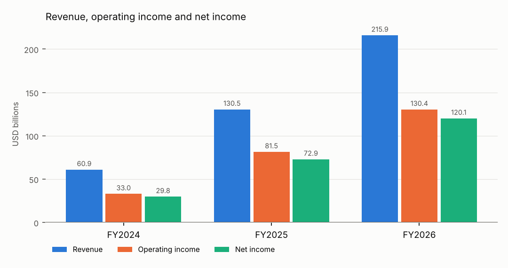
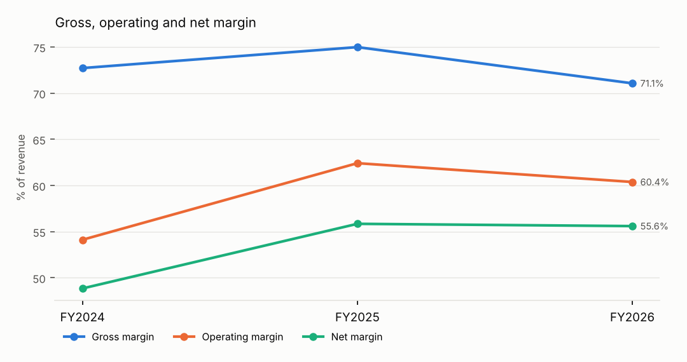
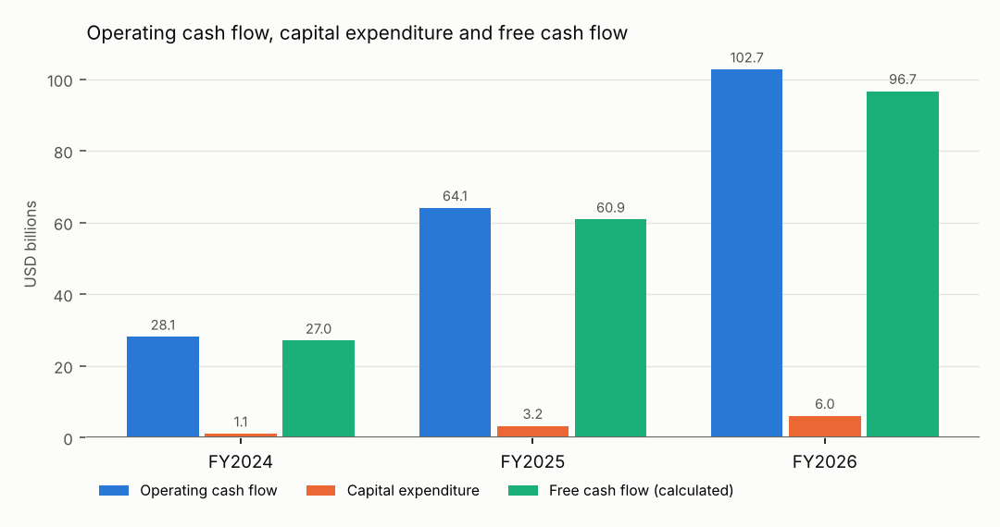
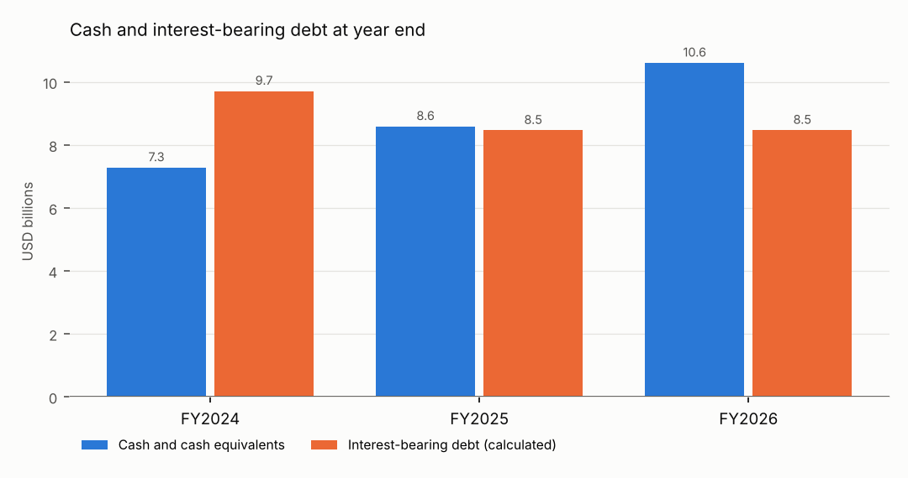

# NVIDIA CORP: three-year performance review (FY2024 to FY2026)

**Investigation by the OFFLINE STUB, a rule-based stand-in that is not an AI model: it quotes filing sentences that contain explicit attribution language and writes no interpretation. Narrative review by an LLM was not performed.**

**Status: READY FOR ANALYST REVIEW, not approved. This is an analytical report, not an investment recommendation.**

CIK 0001045810 · tickers NVDA · SIC 3674 Semiconductors & Related Devices · currency USD · analysis cutoff 2026-11-10 · report revision 0

## Executive summary

- Revenue was $60.9 billion in FY2024 and $215.9 billion in FY2026. [M1][M2]
- Operating margin was 54.1% in FY2024 and 60.4% in FY2026. [M3][M4]
- Net income was $29.8 billion in FY2024 and $120.1 billion in FY2026. [M5][M6]
- Free cash flow (calculated) was $27.0 billion in FY2024 and $96.7 billion in FY2026. [M7][M8]

9 change(s) met the investigation settings and 8 were investigated in the 10-K text: 2 explained with supporting quotes, 2 partly explained, 4 not explained by the available evidence.

Largest changes by investigation priority:

- Revenue rose 114.2% (FY2024->FY2025). Evidence: supported; investigator's assessment: favorable. [M9][M10]
- Capital expenditure rose 202.7% (FY2024->FY2025). Evidence: unsupported / unexplained; investigator's assessment: ambiguous. [M11][M12]
- Net income rose 144.9% (FY2024->FY2025). Evidence: unsupported / unexplained; investigator's assessment: favorable. [M13][M14]

## Three-year financial table

USD millions unless stated. Values are rounded for display; full precision is in `financial_dataset.csv` and `metrics.csv`.

| Line item | FY2024 | FY2025 | FY2026 |
|---|---|---|---|
| Revenue | 60,922 | 130,497 | 215,938 |
| Gross profit | 44,301 | 97,858 | 153,463 |
| Operating income | 32,972 | 81,453 | 130,387 |
| Net income | 29,760 | 72,880 | 120,067 |
| Operating cash flow | 28,090 | 64,089 | 102,718 |
| Capital expenditure | 1,069 | 3,236 | 6,042 |
| Free cash flow (calculated) | 27,021 | 60,853 | 96,676 |
| Cash and cash equivalents | 7,280 | 8,589 | 10,605 |
| Interest-bearing debt (calculated) | 9,709 | 8,463 | 8,468 |
| Gross margin % | 72.7 | 75.0 | 71.1 |
| Operating margin % | 54.1 | 62.4 | 60.4 |
| Net margin % | 48.8 | 55.8 | 55.6 |
| Current ratio (x) | 4.17 | 4.44 | 3.91 |

### Year-over-year changes

| Measure | FY2024->FY2025 | FY2025->FY2026 |
|---|---|---|
| Revenue growth % | +114.2 | +65.5 |
| Gross margin change (pp) | +2.3 | -3.9 |
| Operating margin change (pp) | +8.3 | -2.0 |
| Net margin change (pp) | +7.0 | -0.2 |
| Free cash flow growth % | +125.2 | +58.9 |
| Free cash flow change | 33,832 | 35,823 |
| Cash change | 1,309 | 2,016 |
| Debt change | -1,246 | 5 |

## Charts

*Fiscal periods FY2024 to FY2026; values in USD billions; source: validated metrics (charts/revenue_profit.csv).*

| Revenue, operating income and net income (USD billions) | FY2024 | FY2025 | FY2026 |
|---|---|---|---|
| Revenue | 60.9 | 130.5 | 215.9 |
| Operating income | 33.0 | 81.5 | 130.4 |
| Net income | 29.8 | 72.9 | 120.1 |

*Fiscal periods FY2024 to FY2026; values in % of revenue; source: validated metrics (charts/margins.csv).*

| Gross, operating and net margin (% of revenue) | FY2024 | FY2025 | FY2026 |
|---|---|---|---|
| Gross margin | 72.7 | 75.0 | 71.1 |
| Operating margin | 54.1 | 62.4 | 60.4 |
| Net margin | 48.8 | 55.8 | 55.6 |

*Fiscal periods FY2024 to FY2026; values in USD billions; source: validated metrics (charts/cash_flow.csv).*

| Operating cash flow, capital expenditure and free cash flow (USD billions) | FY2024 | FY2025 | FY2026 |
|---|---|---|---|
| Operating cash flow | 28.1 | 64.1 | 102.7 |
| Capital expenditure | 1.1 | 3.2 | 6.0 |
| Free cash flow (calculated) | 27.0 | 60.9 | 96.7 |

*Fiscal periods FY2024 to FY2026; values in USD billions; source: validated metrics (charts/cash_debt.csv).*

| Cash and interest-bearing debt at year end (USD billions) | FY2024 | FY2025 | FY2026 |
|---|---|---|---|
| Cash and cash equivalents | 7.3 | 8.6 | 10.6 |
| Interest-bearing debt (calculated) | 9.7 | 8.5 | 8.5 |

## Ranked performance changes

Ranked by how far each change exceeds its investigation setting (profit/loss transitions first). The settings decide what to investigate; they are not financial standards.

| # | Change | Years | Observed | Rule | Evidence |
|---|---|---|---|---|---|
| 1 | Revenue rose 114.2% (FY2024->FY2025). | FY2024->FY2025 | +114.2% | revenue_change | Supported |
| 2 | Capital expenditure rose 202.7% (FY2024->FY2025). | FY2024->FY2025 | +202.7% | capex_change | Unsupported / unexplained |
| 3 | Net income rose 144.9% (FY2024->FY2025). | FY2024->FY2025 | +144.9% | net_income_change | Unsupported / unexplained |
| 4 | Revenue rose 65.5% (FY2025->FY2026). | FY2025->FY2026 | +65.5% | revenue_change | Supported |
| 5 | Free cash flow rose 125.2% (FY2024->FY2025). | FY2024->FY2025 | +125.2% | free_cash_flow_change | Partially supported |
| 6 | Capital expenditure rose 86.7% (FY2025->FY2026). | FY2025->FY2026 | +86.7% | capex_change | Unsupported / unexplained |
| 7 | Net income rose 64.7% (FY2025->FY2026). | FY2025->FY2026 | +64.7% | net_income_change | Unsupported / unexplained |
| 8 | Free cash flow rose 58.9% (FY2025->FY2026). | FY2025->FY2026 | +58.9% | free_cash_flow_change | Partially supported |
| 9 | Operating margin moved +8.3 percentage points (FY2024->FY2025). | FY2024->FY2025 | +8.3 pp | operating_margin_change | not investigated |

## Evidence-backed explanations

### 1. Revenue rose 114.2% (FY2024->FY2025).

**Evidence status: Supported.** management explanation backed by verified quotes. Investigator's assessment in the company's context: **favorable**.

**Calculated observation.** Revenue rose 114.2% (FY2024->FY2025). Revenue: $60.9 billion in FY2024, $130.5 billion in FY2025. [M9][M10][M1][M15]

**Management explanation** (attributed to the company, 10-K FY2025): The 10-K states: Revenue from Data Center computing grew 162% driven primarily by demand for our Hopper computing platform used for large language models, recommendation engines, and generative AI applications. [P1]

> “Revenue from Data Center computing grew 162% driven primarily by demand for our Hopper computing platform used for large language models, recommendation engines, and generative AI applications.” [P1]

*Investigation trace: 2 step(s); tools used: get_validated_metric, search_filing_sections, read_source_passage, record_finding; by offline-stub (rule-based, no LLM).*

### 2. Capital expenditure rose 202.7% (FY2024->FY2025).

**Evidence status: Unsupported / unexplained.** no verified quote supports a management explanation. Investigator's assessment in the company's context: **ambiguous**.

**Calculated observation.** Capital expenditure rose 202.7% (FY2024->FY2025). Capital expenditure: $1,069 million in FY2024, $3,236 million in FY2025. [M11][M12][M16][M17]

**Management explanation.** None found in the retrieved filing text.

**Unresolved questions.**

- The retrieved 10-K text does not explain the change in capital expenditure.

*Investigation trace: 2 step(s); tools used: get_validated_metric, search_filing_sections, read_source_passage, record_finding; by offline-stub (rule-based, no LLM).*

### 3. Net income rose 144.9% (FY2024->FY2025).

**Evidence status: Unsupported / unexplained.** no verified quote supports a management explanation. Investigator's assessment in the company's context: **favorable**.

**Calculated observation.** Net income rose 144.9% (FY2024->FY2025). Net income: $29.8 billion in FY2024, $72.9 billion in FY2025. [M13][M14][M5][M18]

**Management explanation.** None found in the retrieved filing text.

**Unresolved questions.**

- The retrieved 10-K text does not explain the change in net income.

*Investigation trace: 2 step(s); tools used: get_validated_metric, search_filing_sections, read_source_passage, record_finding; by offline-stub (rule-based, no LLM).*

### 4. Revenue rose 65.5% (FY2025->FY2026).

**Evidence status: Supported.** management explanation backed by verified quotes. Investigator's assessment in the company's context: **favorable**.

**Calculated observation.** Revenue rose 65.5% (FY2025->FY2026). Revenue: $130.5 billion in FY2025, $215.9 billion in FY2026. [M19][M20][M15][M2]

**Management explanation** (attributed to the company, 10-K FY2026): The 10-K states: Revenue from Data Center computing grew 59% driven by demand for our Blackwell computing platform. [P2]

> “Revenue from Data Center computing grew 59% driven by demand for our Blackwell computing platform.” [P2]

*Investigation trace: 2 step(s); tools used: get_validated_metric, search_filing_sections, read_source_passage, record_finding; by offline-stub (rule-based, no LLM).*

### 5. Free cash flow rose 125.2% (FY2024->FY2025).

**Evidence status: Partially supported.** open questions remain. Investigator's assessment in the company's context: **favorable**.

**Calculated observation.** Free cash flow rose 125.2% (FY2024->FY2025). Free cash flow: $27.0 billion in FY2024, $60.9 billion in FY2025. [M21][M22][M7][M23]

**Management explanation** (attributed to the company, 10-K FY2025): The 10-K states: Cash provided by operating activities increased in fiscal year 2025 compared to fiscal year 2024, due to growth in revenue. [P3]

> “Cash provided by operating activities increased in fiscal year 2025 compared to fiscal year 2024, due to growth in revenue.” [P3]

**Unresolved questions.**

- The retrieved 10-K text does not explain the change in capital expenditure.

*Investigation trace: 2 step(s); tools used: get_validated_metric, search_filing_sections, read_source_passage, record_finding; by offline-stub (rule-based, no LLM).*

### 6. Capital expenditure rose 86.7% (FY2025->FY2026).

**Evidence status: Unsupported / unexplained.** no verified quote supports a management explanation. Investigator's assessment in the company's context: **ambiguous**.

**Calculated observation.** Capital expenditure rose 86.7% (FY2025->FY2026). Capital expenditure: $3,236 million in FY2025, $6,042 million in FY2026. [M24][M25][M17][M26]

**Management explanation.** None found in the retrieved filing text.

**Unresolved questions.**

- The retrieved 10-K text does not explain the change in capital expenditure.

*Investigation trace: 2 step(s); tools used: get_validated_metric, search_filing_sections, read_source_passage, record_finding; by offline-stub (rule-based, no LLM).*

### 7. Net income rose 64.7% (FY2025->FY2026).

**Evidence status: Unsupported / unexplained.** no verified quote supports a management explanation. Investigator's assessment in the company's context: **favorable**.

**Calculated observation.** Net income rose 64.7% (FY2025->FY2026). Net income: $72.9 billion in FY2025, $120.1 billion in FY2026. [M27][M28][M18][M6]

**Management explanation.** None found in the retrieved filing text.

**Unresolved questions.**

- The retrieved 10-K text does not explain the change in net income.

*Investigation trace: 2 step(s); tools used: get_validated_metric, search_filing_sections, read_source_passage, record_finding; by offline-stub (rule-based, no LLM).*

### 8. Free cash flow rose 58.9% (FY2025->FY2026).

**Evidence status: Partially supported.** open questions remain. Investigator's assessment in the company's context: **favorable**.

**Calculated observation.** Free cash flow rose 58.9% (FY2025->FY2026). Free cash flow: $60.9 billion in FY2025, $96.7 billion in FY2026. [M29][M30][M23][M8]

**Management explanation** (attributed to the company, 10-K FY2026): The 10-K states: Cash provided by operating activities increased in fiscal year 2026 compared to fiscal year 2025, due to higher revenue. [P4]

> “Cash provided by operating activities increased in fiscal year 2026 compared to fiscal year 2025, due to higher revenue.” [P4]

**Unresolved questions.**

- The retrieved 10-K text does not explain the change in capital expenditure.

*Investigation trace: 2 step(s); tools used: get_validated_metric, search_filing_sections, read_source_passage, record_finding; by offline-stub (rule-based, no LLM).*

## Risks, uncertainties and missing information

- Not investigated: Operating margin moved +8.3 percentage points (FY2024->FY2025).
- 1 lower-ranked change(s) not investigated (max_findings = 8).
- Investigation by the OFFLINE STUB, a rule-based stand-in that is not an AI model: it quotes filing sentences that contain explicit attribution language and writes no interpretation. Narrative review by an LLM was not performed.
- Management explanations are the company's own account. They are quoted, not verified independently, and timing alone is not treated as cause.

## Sources

Filing passages cited in this report. Each one can be found again in the source document at the given character range of its extracted text.

**[P1]** 10-K 0001045810-25-000023, filed 2025-02-26, FY2025, Item 7. Management's Discussion and Analysis (MD&A). https://www.sec.gov/Archives/edgar/data/1045810/000104581025000023/nvda-20250126.htm (characters 210930-212003; passage `psg:0001045810-25-000023:item_7:027`)

**[P2]** 10-K 0001045810-26-000021, filed 2026-02-25, FY2026, Item 7. Management's Discussion and Analysis (MD&A). https://www.sec.gov/Archives/edgar/data/1045810/000104581026000021/nvda-20260125.htm (characters 202845-204013; passage `psg:0001045810-26-000021:item_7:020`)

**[P3]** 10-K 0001045810-25-000023, filed 2025-02-26, FY2025, Item 7. Management's Discussion and Analysis (MD&A). https://www.sec.gov/Archives/edgar/data/1045810/000104581025000023/nvda-20250126.htm (characters 219077-220149; passage `psg:0001045810-25-000023:item_7:035`)

**[P4]** 10-K 0001045810-26-000021, filed 2026-02-25, FY2026, Item 7. Management's Discussion and Analysis (MD&A). https://www.sec.gov/Archives/edgar/data/1045810/000104581026000021/nvda-20260125.htm (characters 211722-212822; passage `psg:0001045810-26-000021:item_7:028`)

Data sources:

- submissions: https://data.sec.gov/submissions/CIK0001045810.json (retrieved 2026-11-10 07:52 UTC, SHA-256 `db787ea656392c04…`)
- company_facts: https://data.sec.gov/api/xbrl/companyfacts/CIK0001045810.json (retrieved 2026-11-10 07:52 UTC, SHA-256 `19ef503a5770f566…`)

## Calculation notes

Every number in the text cites one of these validated metrics. Values are full precision; formulas and input fact IDs trace back to XBRL facts in `facts_audit_trail.csv`.

**[M1]** `metric:revenue:FY2024` = 60922000000 USD. Formula: revenue (reported). Inputs: `fact:revenue:FY2024:6fdc22f2b3`.

**[M2]** `metric:revenue:FY2026` = 215938000000 USD. Formula: revenue (reported). Inputs: `fact:revenue:FY2026:0becfd48b4`.

**[M3]** `metric:operating_margin:FY2024` = 54.12166376678375627852007484980795 percent. Formula: operating_income / revenue x 100. Inputs: `fact:operating_income:FY2024:948cb34876`, `fact:revenue:FY2024:6fdc22f2b3`.

**[M4]** `metric:operating_margin:FY2026` = 60.38168363141272031786901795885856 percent. Formula: operating_income / revenue x 100. Inputs: `fact:operating_income:FY2026:f5c0574d0c`, `fact:revenue:FY2026:0becfd48b4`.

**[M5]** `metric:net_income:FY2024` = 29760000000 USD. Formula: net_income (reported). Inputs: `fact:net_income:FY2024:d5ea161a12`.

**[M6]** `metric:net_income:FY2026` = 120067000000 USD. Formula: net_income (reported). Inputs: `fact:net_income:FY2026:57bbf360a9`.

**[M7]** `metric:free_cash_flow:FY2024` = 27021000000 USD. Formula: operating_cash_flow - capital_expenditure (capex as a positive outflow). Inputs: `fact:operating_cash_flow:FY2024:c5def07eb3`, `fact:capital_expenditure:FY2024:4bf4793dfd`. Note: calculated non-GAAP measure.

**[M8]** `metric:free_cash_flow:FY2026` = 96676000000 USD. Formula: operating_cash_flow - capital_expenditure (capex as a positive outflow). Inputs: `fact:operating_cash_flow:FY2026:dd2337faa7`, `fact:capital_expenditure:FY2026:f085b6e32d`. Note: calculated non-GAAP measure.

**[M9]** `metric:revenue_growth:FY2024->FY2025` = 114.2034076359935655428252519615246 percent. Formula: (revenue[FY2025] - revenue[FY2024]) / revenue[FY2024] x 100. Inputs: `metric:revenue:FY2024`, `metric:revenue:FY2025`.

**[M10]** `metric:revenue_change:FY2024->FY2025` = 69575000000 USD. Formula: revenue[FY2025] - revenue[FY2024]. Inputs: `metric:revenue:FY2024`, `metric:revenue:FY2025`.

**[M11]** `metric:capital_expenditure_growth:FY2024->FY2025` = 202.7128157156220767072029934518241 percent. Formula: (capital_expenditure[FY2025] - capital_expenditure[FY2024]) / capital_expenditure[FY2024] x 100. Inputs: `metric:capital_expenditure:FY2024`, `metric:capital_expenditure:FY2025`.

**[M12]** `metric:capital_expenditure_change:FY2024->FY2025` = 2167000000 USD. Formula: capital_expenditure[FY2025] - capital_expenditure[FY2024]. Inputs: `metric:capital_expenditure:FY2024`, `metric:capital_expenditure:FY2025`.

**[M13]** `metric:net_income_growth:FY2024->FY2025` = 144.8924731182795698924731182795699 percent. Formula: (net_income[FY2025] - net_income[FY2024]) / net_income[FY2024] x 100. Inputs: `metric:net_income:FY2024`, `metric:net_income:FY2025`.

**[M14]** `metric:net_income_change:FY2024->FY2025` = 43120000000 USD. Formula: net_income[FY2025] - net_income[FY2024]. Inputs: `metric:net_income:FY2024`, `metric:net_income:FY2025`.

**[M15]** `metric:revenue:FY2025` = 130497000000 USD. Formula: revenue (reported). Inputs: `fact:revenue:FY2025:2803453d78`.

**[M16]** `metric:capital_expenditure:FY2024` = 1069000000 USD. Formula: capital_expenditure (reported). Inputs: `fact:capital_expenditure:FY2024:4bf4793dfd`.

**[M17]** `metric:capital_expenditure:FY2025` = 3236000000 USD. Formula: capital_expenditure (reported). Inputs: `fact:capital_expenditure:FY2025:0721f5d6bc`.

**[M18]** `metric:net_income:FY2025` = 72880000000 USD. Formula: net_income (reported). Inputs: `fact:net_income:FY2025:5230dd21dc`.

**[M19]** `metric:revenue_growth:FY2025->FY2026` = 65.47353579009479145114447075411695 percent. Formula: (revenue[FY2026] - revenue[FY2025]) / revenue[FY2025] x 100. Inputs: `metric:revenue:FY2025`, `metric:revenue:FY2026`.

**[M20]** `metric:revenue_change:FY2025->FY2026` = 85441000000 USD. Formula: revenue[FY2026] - revenue[FY2025]. Inputs: `metric:revenue:FY2025`, `metric:revenue:FY2026`.

**[M21]** `metric:free_cash_flow_growth:FY2024->FY2025` = 125.2063210095851374856593020243514 percent. Formula: (free_cash_flow[FY2025] - free_cash_flow[FY2024]) / free_cash_flow[FY2024] x 100. Inputs: `metric:free_cash_flow:FY2024`, `metric:free_cash_flow:FY2025`.

**[M22]** `metric:free_cash_flow_change:FY2024->FY2025` = 33832000000 USD. Formula: free_cash_flow[FY2025] - free_cash_flow[FY2024]. Inputs: `metric:free_cash_flow:FY2024`, `metric:free_cash_flow:FY2025`.

**[M23]** `metric:free_cash_flow:FY2025` = 60853000000 USD. Formula: operating_cash_flow - capital_expenditure (capex as a positive outflow). Inputs: `fact:operating_cash_flow:FY2025:358da70118`, `fact:capital_expenditure:FY2025:0721f5d6bc`. Note: calculated non-GAAP measure.

**[M24]** `metric:capital_expenditure_growth:FY2025->FY2026` = 86.71199011124845488257107540173053 percent. Formula: (capital_expenditure[FY2026] - capital_expenditure[FY2025]) / capital_expenditure[FY2025] x 100. Inputs: `metric:capital_expenditure:FY2025`, `metric:capital_expenditure:FY2026`.

**[M25]** `metric:capital_expenditure_change:FY2025->FY2026` = 2806000000 USD. Formula: capital_expenditure[FY2026] - capital_expenditure[FY2025]. Inputs: `metric:capital_expenditure:FY2025`, `metric:capital_expenditure:FY2026`.

**[M26]** `metric:capital_expenditure:FY2026` = 6042000000 USD. Formula: capital_expenditure (reported). Inputs: `fact:capital_expenditure:FY2026:f085b6e32d`.

**[M27]** `metric:net_income_growth:FY2025->FY2026` = 64.74615806805708013172338090010977 percent. Formula: (net_income[FY2026] - net_income[FY2025]) / net_income[FY2025] x 100. Inputs: `metric:net_income:FY2025`, `metric:net_income:FY2026`.

**[M28]** `metric:net_income_change:FY2025->FY2026` = 47187000000 USD. Formula: net_income[FY2026] - net_income[FY2025]. Inputs: `metric:net_income:FY2025`, `metric:net_income:FY2026`.

**[M29]** `metric:free_cash_flow_growth:FY2025->FY2026` = 58.86809195931178413553974331585953 percent. Formula: (free_cash_flow[FY2026] - free_cash_flow[FY2025]) / free_cash_flow[FY2025] x 100. Inputs: `metric:free_cash_flow:FY2025`, `metric:free_cash_flow:FY2026`.

**[M30]** `metric:free_cash_flow_change:FY2025->FY2026` = 35823000000 USD. Formula: free_cash_flow[FY2026] - free_cash_flow[FY2025]. Inputs: `metric:free_cash_flow:FY2025`, `metric:free_cash_flow:FY2026`.

## Method

- Fiscal years are identified from the period-of-report of original 10-K filings filed by the cutoff, never from XBRL fiscal-year labels. Restated values from later 10-Ks are preferred; originals are kept in the audit trail.
- Free cash flow = operating cash flow minus capital expenditure (as a positive outflow). It is a calculated, non-GAAP measure.
- Interest-bearing debt = long-term debt including current maturities + commercial paper + short-term borrowings. Total liabilities is never used as a substitute.
- Margin changes are in percentage points. Percentage growth from a zero or negative base is suppressed and the absolute change is given instead.
- Investigation used offline-stub (rule-based, no LLM). Quotes are checked verbatim against the filing by code; an evidence status can be lowered by checks but never raised by the model.
- Filings considered: 10-K 0001045810-24-000029 (2024-02-21), 10-K 0001045810-25-000023 (2025-02-26), 10-K 0001045810-26-000021 (2026-02-25).

---
Run `run-20261110-075214-1871f3` state: READY_FOR_REVIEW.
